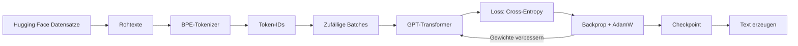

# 🧠 MiniLLM Studio

**Ein eigenes Sprachmodell (GPT) – von Grund auf gebaut, mit Hugging-Face-Daten trainiert und in einer App live sichtbar gemacht.**

Abschlussprojekt der Wiss · Autor: Joel Weber


<sub>Live-Dashboard während/nach einem kurzen Trainingslauf (300 Schritte).</sub>

---

## Worum geht es?

ChatGPT & Co. wirken wie Magie. In diesem Projekt habe ich gezeigt, dass dahinter erstaunlich wenig steckt – und alles
selbst gebaut, **ohne fertige Modelle oder Tokenizer-Bibliotheken**:

| Baustein | Selbst geschrieben in | Was es macht |
|---|---|---|
| **BPE-Tokenizer** | [`minillm/tokenizer.py`](minillm/tokenizer.py) | zerlegt Text in Tokens, lernt häufige Buchstabenfolgen selbst |
| **GPT-Transformer** | [`minillm/model.py`](minillm/model.py) | Embeddings, Causal Self-Attention, MLP, LayerNorm, Residuals |
| **Trainings-Schleife** | [`minillm/trainer.py`](minillm/trainer.py) | AdamW, Warmup + Kosinus-Lernrate, Gradient Clipping, Validierung |
| **Text-Erzeugung** | [`minillm/generate.py`](minillm/generate.py) | Temperatur, Top-k, Top-p (Nucleus-Sampling) |
| **Daten-Pipeline** | [`minillm/catalog.py`](minillm/catalog.py), [`data.py`](minillm/data.py) | 34 Hugging-Face-Datensätze per Streaming laden und mischen |
| **App** | [`app.py`](app.py), [`ui/`](ui) | Streamlit-Oberfläche mit vielen interaktiven Diagrammen |

Verwendet wird nur **PyTorch** (für Tensoren und automatische Ableitung), **`datasets`** (zum Laden der Daten),
**Streamlit** und **Plotly** (für die App).

## Was kann die App?

Die App führt mit sechs Seiten durch den ganzen Weg von den Rohdaten bis zum fertigen Modell:

1. **📚 Daten** – 34 Datensätze von Hugging Face zur Auswahl (Geschichten, Wikipedia, Web, Nachrichten, **Code**, Chat,
   Deutsch …), mit Filter, Vorschau und fertigen Mischungen (z. B. „Code“, „Deutsch“, „Text + Code“).
   → [Alle Datensätze](docs/DATASETS.md)
2. **🔤 Tokenizer** – eigenes Vokabular trainieren, Text in farbige Tokens zerlegen, Zipf-Verteilung ansehen.
3. **🧠 Modell** – Grösse per Regler einstellen; die Architektur wird live als Diagramm gezeichnet, dazu Parameter-Anzahl
   und Speicherbedarf.
4. **🏋️ Training** – Live-Kurven (Loss, Lernrate, Gradienten, Perplexity), Beispieltexte, Aufmerksamkeits-Heatmaps,
   Embedding-Landkarte und Gewichts-Histogramme – alles während das Modell lernt.
5. **✨ Generieren** – Text schreiben lassen und verstehen, *warum* das Modell sich so entscheidet (Wahrscheinlichkeiten,
   Temperatur-Effekt, Attention).
6. **📊 Läufe vergleichen** – mehrere Trainings übereinander legen.

<table>
<tr>
<td width="50%"><br><sub><b>Datensätze auswählen</b></sub></td>
<td width="50%"><br><sub><b>Architektur als Diagramm</b></sub></td>
</tr>
<tr>
<td><br><sub><b>Tokenizer ausprobieren</b></sub></td>
<td><br><sub><b>Was schaut das Modell an? (Attention)</b></sub></td>
</tr>
<tr>
<td><br><sub><b>Embedding-Raum</b></sub></td>
<td><br><sub><b>Text erzeugen</b></sub></td>
</tr>
</table>

## Schnellstart

Voraussetzung: **Python 3.10+**. Eine Grafikkarte ist *nicht* nötig – alles läuft auf der CPU.

```bash
git clone https://github.com/sideforge/MiniLLM-Studio.git
cd MiniLLM-Studio
pip install -r requirements.txt
streamlit run app.py
```

Dann im Browser (öffnet sich automatisch):

1. **Daten** → Mischung „📖 Geschichten (schnell)“ klicken → **Laden & vorbereiten** (ca. 1 Minute)
2. **Training** → **Training starten** (1500 Schritte ≈ 10 Minuten auf einem Laptop)
3. **Generieren** → Prompt eingeben → **Erzeugen**

Ohne App geht es auch über die Kommandozeile:

```bash
python train_cli.py --datasets tinystories=5000 shakespeare=300 --steps 1500 --name test
```

## Wie funktioniert es?



**Die Aufgabe des Modells ist simpel:** Es sieht ein Textstück und muss das **nächste Token** vorhersagen. Der Fehler
(*Loss*) wird per Backpropagation auf alle Gewichte zurückgerechnet, und AdamW verschiebt sie ein kleines Stück in die
bessere Richtung. Nach tausenden Wiederholungen entstehen erst Buchstaben, dann Wörter, dann ganze Sätze.

**Tokenizer (BPE).** Start mit den 256 Bytes. Immer wieder wird das häufigste benachbarte Paar zu einem neuen Token
verschmolzen, bis das gewünschte Vokabular erreicht ist. Das funktioniert für jede Sprache und jeden Code, weil auf
Byte-Ebene gearbeitet wird.

**Modell (GPT).**
`Token-Embedding + Positions-Embedding → N × [LayerNorm → Causal Self-Attention → +Residual → LayerNorm → MLP → +Residual] → LayerNorm → Linear → Softmax`.
Die Ausgabe-Schicht teilt ihre Gewichte mit dem Embedding (*Weight Tying*). Die „Causal Mask“ verhindert, dass ein Token
in die Zukunft schaut.

**Training.** AdamW mit Weight Decay, Lernrate mit linearem Warmup und Kosinus-Abfall, Gradient Clipping. Alle paar
Schritte wird auf **Validierungsdaten** geprüft, die das Modell nie sieht – so erkennt man Overfitting. Die
*Perplexity* `e^Loss` sagt, zwischen wie vielen Tokens das Modell im Schnitt schwankt.

## Ergebnisse

Ein Trainingslauf mit den Standard-Einstellungen, **nur auf der CPU** (kein Grafikprozessor):

| | |
|---|---|
| Daten | 6000 Geschichten aus *TinyStories* + 400 Textstücke *Tiny Shakespeare* (≈ 2 Mio. Tokens) |
| Tokenizer | eigenes BPE, Vokabular 1024 (2.84 Zeichen pro Token) |
| Modell | 4 Schichten · 4 Köpfe · Breite 128 · Kontext 128 · **940'800 Parameter** |
| Training | 1500 Schritte × 16 Fenster · ≈ 3 Mio. Tokens gesehen · **9 min 22 s** |
| Val-Loss | 7.0 (Zufall: ln 1024 ≈ 6.93) → **2.95**, Perplexity ≈ 19 |

Beispieltext des Modells nach dem Training (Prompt: *„Once upon a time“*, unverändert übernommen):

> Once upon a time there was a little girl named Lily. One day, she saw a little boy named Sarah. She loved to play
> with her facross. Suddenly, something eagicious sounded. He walked and saw a shiny bit. It was pully to go with the car.

Das Modell hat in 10 Minuten Satzbau, Namen, Dialoge und typische Kindergeschichten-Wörter gelernt – manche Wörter
sind noch erfunden („facross“, „eagicious“). Mit mehr Schritten, mehr Daten und einem grösseren Modell wird das
deutlich besser.

## Grenzen (ehrlich gesagt)

- Das Modell hat **< 1 Mio. Parameter**; GPT-3 hat 175 Milliarden. Es lernt Sprachmuster, aber **kein Weltwissen**.
- Code-Datensätze sind enthalten, aber für kleine Modelle sehr schwer: erwarte Code-*aussehenden* Text, nicht
  funktionierende Programme. Für gute Ergebnisse wären viel mehr Daten, Rechenzeit und ein grösseres Modell nötig.
- Alle Datensätze haben eigene Lizenzen – siehe die Links in [`docs/DATASETS.md`](docs/DATASETS.md).

## Projektstruktur

```
MiniLLM-Studio/
├── app.py                 # Streamlit-App (Einstieg)
├── train_cli.py           # Training ohne App
├── minillm/               # der eigentliche Kern
│   ├── catalog.py         #   Katalog der 34 Hugging-Face-Datensätze
│   ├── data.py            #   Daten laden, Tokenizer trainieren, Batches
│   ├── tokenizer.py       #   BPE-Tokenizer (selbst gebaut)
│   ├── model.py           #   GPT-Transformer (selbst gebaut)
│   ├── trainer.py         #   Trainings-Schleife mit Live-Metriken
│   └── generate.py        #   Sampling (Temperatur, Top-k, Top-p)
├── ui/                    # Seiten der App
├── tests/                 # automatische Tests
├── tools/                 # Skript für die Screenshots
└── docs/                  # Datensatz-Liste, Screenshots
```

## Tests

```bash
python -m pytest
```

Die Tests prüfen u. a. dass der Tokenizer verlustfrei ist (inkl. Umlaute und Emojis), dass die Attention wirklich
„kausal“ ist (die Zukunft ändert die Vergangenheit nicht), dass die Parameter-Zählung stimmt und dass das Modell einen
einzelnen Batch auswendig lernen kann (Beweis, dass Backpropagation funktioniert).

## Quellen & Inspiration

- Vaswani et al., *Attention Is All You Need* (2017)
- Radford et al., *Language Models are Unsupervised Multitask Learners* (GPT-2, 2019)
- Eldan & Li, *TinyStories* (2023)
- Sennrich et al., *Neural Machine Translation of Rare Words with Subword Units* (BPE, 2016)
- Andrej Karpathy, *nanoGPT* und *Let's build GPT* (Inspiration für die Architektur)

## Lizenz

[MIT](LICENSE)
