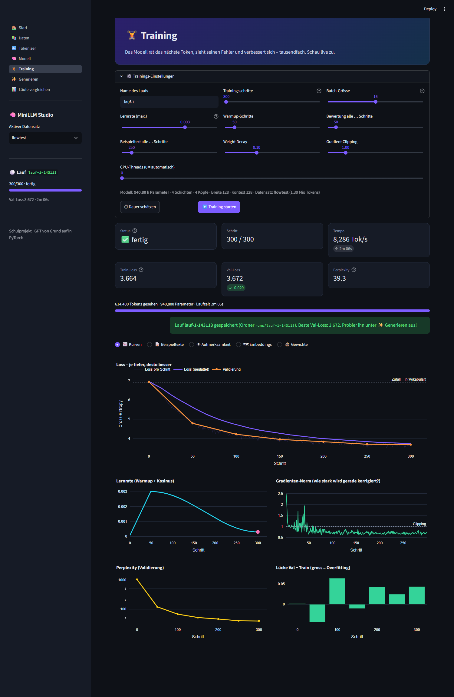
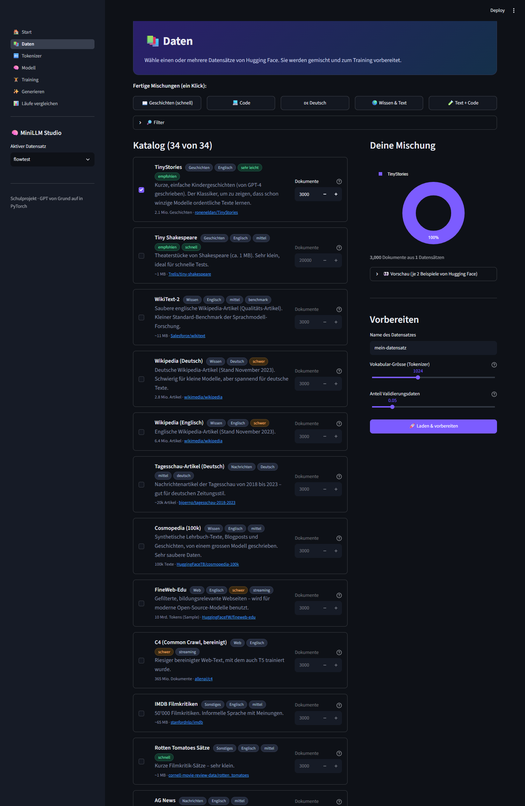
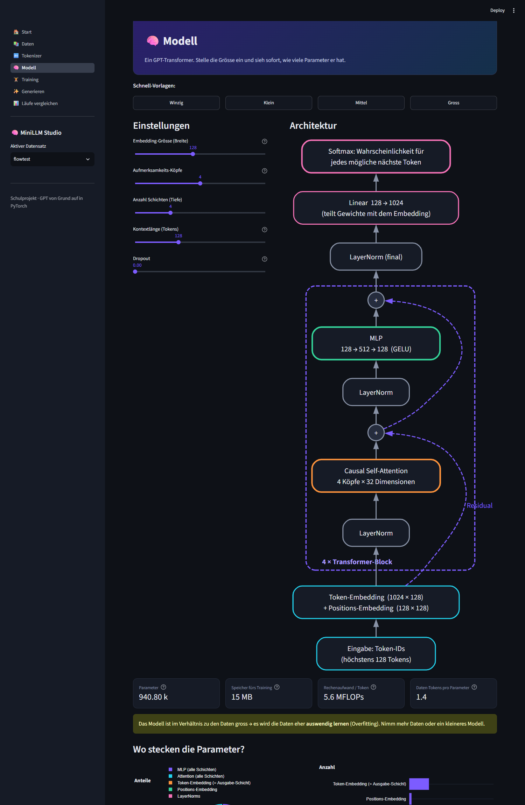
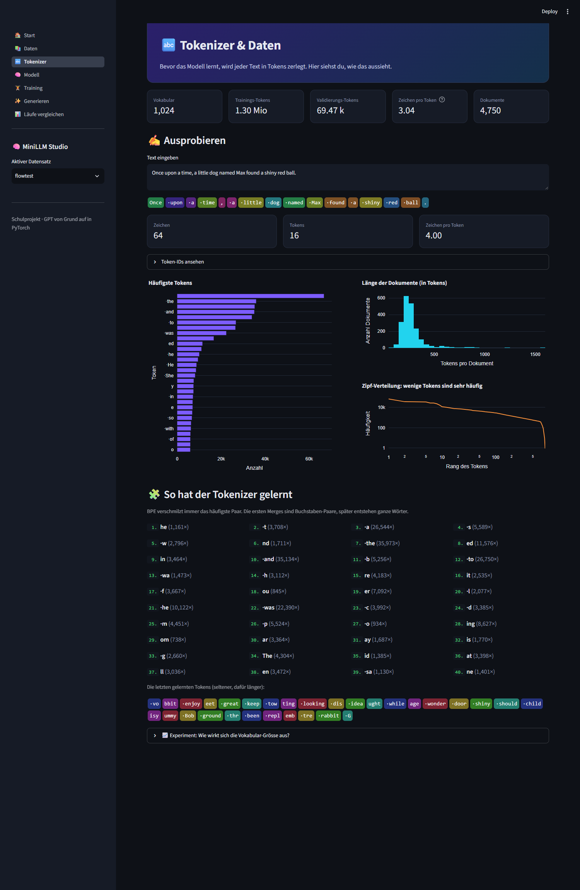
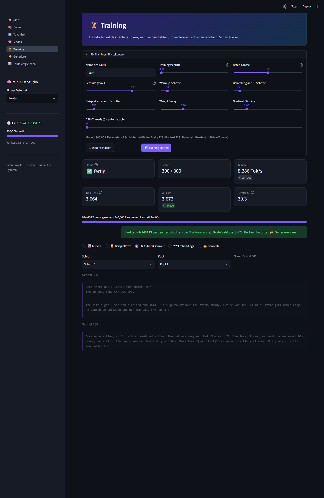
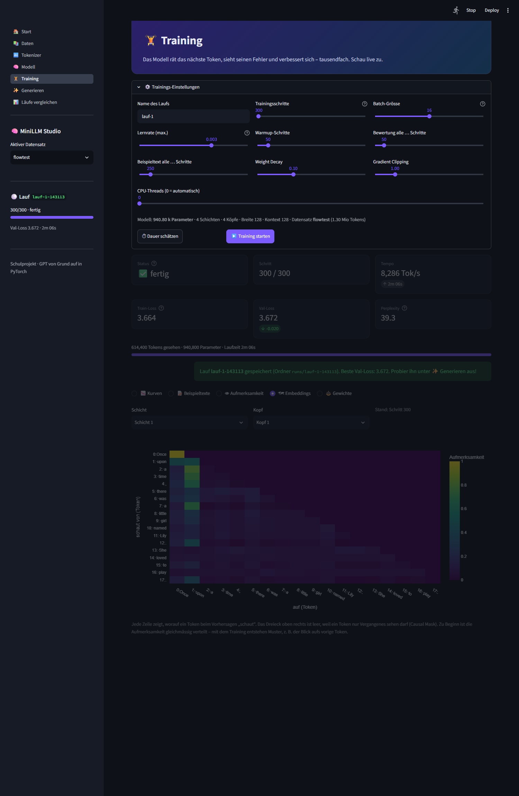
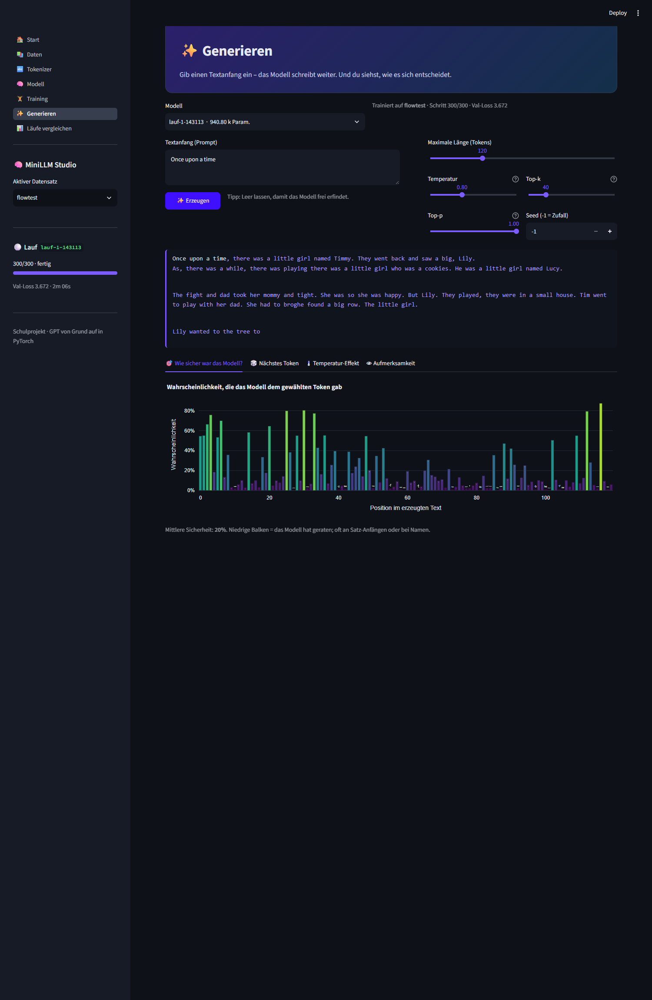
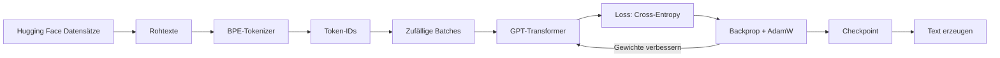

# 🧠 MiniLLM Studio

**Ein eigenes Sprachmodell (GPT) – von Grund auf gebaut, mit Hugging-Face-Daten trainiert und in einer App live sichtbar gemacht.**

Abschlussprojekt der Wiss · Autor: Joel Weber


<sub>Live-Dashboard während/nach einem kurzen Trainingslauf (300 Schritte).</sub>

---

> 🎓 **Neu hier?** Springe zu [LLMs verstehen – Einstieg für Anfänger](#-llms-verstehen--einstieg-für-anfänger).

## Worum geht es?

ChatGPT & Co. wirken wie Magie. In diesem Projekt habe ich gezeigt, dass dahinter erstaunlich wenig steckt – und alles
selbst gebaut, **ohne fertige Modelle oder Tokenizer-Bibliotheken**:

| Baustein | Selbst geschrieben in | Was es macht |
|---|---|---|
| **BPE-Tokenizer** | [`minillm/tokenizer.py`](minillm/tokenizer.py) | zerlegt Text in Tokens, lernt häufige Buchstabenfolgen selbst |
| **GPT-Transformer** | [`minillm/model.py`](minillm/model.py) | Embeddings, Causal Self-Attention, MLP, LayerNorm, Residuals |
| **Trainings-Schleife** | [`minillm/trainer.py`](minillm/trainer.py) | AdamW, Warmup + Kosinus-Lernrate, Gradient Clipping, Validierung |
| **Text-Erzeugung** | [`minillm/generate.py`](minillm/generate.py) | Temperatur, Top-k, Top-p (Nucleus-Sampling) |
| **Daten-Pipeline** | [`minillm/catalog.py`](minillm/catalog.py), [`data.py`](minillm/data.py) | 34 Hugging-Face-Datensätze per Streaming laden und mischen |
| **App** | [`app.py`](app.py), [`ui/`](ui) | Streamlit-Oberfläche mit vielen interaktiven Diagrammen |

Verwendet wird nur **PyTorch** (für Tensoren und automatische Ableitung), **`datasets`** (zum Laden der Daten),
**Streamlit** und **Plotly** (für die App).

## Was kann die App?

Die App führt mit sechs Seiten durch den ganzen Weg von den Rohdaten bis zum fertigen Modell:

1. **📚 Daten** – 34 Datensätze von Hugging Face zur Auswahl (Geschichten, Wikipedia, Web, Nachrichten, **Code**, Chat,
   Deutsch …), mit Filter, Vorschau und fertigen Mischungen (z. B. „Code“, „Deutsch“, „Text + Code“).
   → [Alle Datensätze](docs/DATASETS.md)
2. **🔤 Tokenizer** – eigenes Vokabular trainieren, Text in farbige Tokens zerlegen, Zipf-Verteilung ansehen.
3. **🧠 Modell** – Grösse per Regler einstellen; die Architektur wird live als Diagramm gezeichnet, dazu Parameter-Anzahl
   und Speicherbedarf.
4. **🏋️ Training** – Live-Kurven (Loss, Lernrate, Gradienten, Perplexity), Beispieltexte, Aufmerksamkeits-Heatmaps,
   Embedding-Landkarte und Gewichts-Histogramme – alles während das Modell lernt.
5. **✨ Generieren** – Text schreiben lassen und verstehen, *warum* das Modell sich so entscheidet (Wahrscheinlichkeiten,
   Temperatur-Effekt, Attention).
6. **📊 Läufe vergleichen** – mehrere Trainings übereinander legen.

<table>
<tr>
<td width="50%"><br><sub><b>Datensätze auswählen</b></sub></td>
<td width="50%"><br><sub><b>Architektur als Diagramm</b></sub></td>
</tr>
<tr>
<td><br><sub><b>Tokenizer ausprobieren</b></sub></td>
<td><br><sub><b>Was schaut das Modell an? (Attention)</b></sub></td>
</tr>
<tr>
<td><br><sub><b>Embedding-Raum</b></sub></td>
<td><br><sub><b>Text erzeugen</b></sub></td>
</tr>
</table>

## Schnellstart

Voraussetzung: **Python 3.10+**. Wenn eine **Grafikkarte (GPU)** da ist, wird sie automatisch benutzt und voll
ausgelastet (siehe [GPU-Unterstützung](#gpu-unterstützung)). Ohne GPU läuft alles auf der CPU, nur langsamer.

```bash
git clone https://github.com/sideforge/MiniLLM-Studio.git
cd MiniLLM-Studio
pip install -r requirements.txt
streamlit run app.py
```

Dann im Browser (öffnet sich automatisch):

1. **Daten** → Mischung „📖 Geschichten (schnell)“ klicken → **Laden & vorbereiten** (ca. 1 Minute)
2. **Training** → **Training starten** (1500 Schritte ≈ 10 Minuten auf einem Laptop)
3. **Generieren** → Prompt eingeben → **Erzeugen**

Ohne App geht es auch über die Kommandozeile:

```bash
python train_cli.py --datasets tinystories=5000 shakespeare=300 --steps 1500 --name test
```

## GPU-Unterstützung

Training **und** Text-Erzeugung laufen automatisch auf der schnellsten Grafikkarte, die PyTorch findet
(Reihenfolge: NVIDIA/AMD → Intel → Apple → sonst CPU). Welches Gerät benutzt wird, steht in der Seitenleiste und im
Training-Dashboard. Damit die GPU wirklich **voll ausgelastet** ist:

| Massnahme | Wirkung |
|---|---|
| **Auto-Batch** (Standard) | Probiert immer grössere Batches, bis der Grafikspeicher voll ist, und nimmt das Maximum (minus Reserve) |
| **Mixed Precision** (bf16/fp16) | Rechnet mit 16-Bit-Zahlen: halber Speicher, auf GPUs oft 2–3× schneller |
| **TF32** und cuDNN-Autotuner | Schnellere Matrix-Multiplikation auf NVIDIA-Karten |
| **Daten im GPU-Speicher** | Die Batches entstehen direkt auf der GPU, die Karte wartet nie auf die CPU |
| **Fused AdamW** | Der ganze Optimierungs-Schritt ist ein einziger GPU-Kernel |
| **Seltenes Synchronisieren** | Loss und Gradienten werden nur alle 10 Schritte von der GPU geholt, damit sie nie ins Leere läuft |
| **`torch.compile`** | Fasst viele kleine GPU-Operationen zu wenigen grossen zusammen (nur NVIDIA mit Triton, sonst automatisch aus) |

**Prüfen, ob die GPU wirklich voll arbeitet.** Im Training-Dashboard erscheint bei NVIDIA-Karten eine Live-Anzeige
mit **GPU-Auslastung in %**, Grafikspeicher, Leistung in Watt und Temperatur (gemessen mit `nvidia-smi`). Das Ziel sind
90–100 %. Liegt die Auslastung darunter, sagt die App es dir.

**Wichtig: Ein winziges Modell kann eine grosse GPU nicht auslasten**, egal wie gut der Code ist. Es hat schlicht zu
wenig zu rechnen. Darum gibt es auf der Seite **🧠 Modell** den Knopf **„🚀 GPU-Maximum“**: Er wählt abhängig vom
Grafikspeicher die passende Grösse (z. B. ca. 12 Schichten · Breite 768 ab 12 GB, ca. 16 Schichten · Breite 1024 ab
20 GB). Zusammen mit dem Auto-Batch wird die Karte dann so ausgelastet, wie es mit PyTorch geht. Für die letzten
Prozente kann in der NVIDIA-Systemsteuerung noch **„Energieverwaltung: Maximale Leistung bevorzugen“** und in Windows
der Energiesparplan **„Höchstleistung“** helfen.

**PyTorch mit GPU-Unterstützung installieren.** Das normale `pip install torch` liefert unter Windows oft die reine
CPU-Version. Zeigt die App „CPU“, obwohl eine NVIDIA-Karte eingebaut ist, dann den passenden Befehl auf
[pytorch.org/get-started/locally](https://pytorch.org/get-started/locally/) auswählen (Pip + CUDA), z. B.:

```bash
pip install torch --index-url https://download.pytorch.org/whl/cu128
```

Prüfen, ob es klappt:

```bash
python -c "import torch; print(torch.cuda.is_available(), torch.cuda.get_device_name(0))"
```

Auf der Kommandozeile gibt es dafür `--device auto|cpu|cuda|xpu|mps`, `--batch 0` (= Auto) und `--no-amp`.

> **Ehrlicher Hinweis:** Der GPU-Code ist nach den üblichen PyTorch-Mustern gebaut, und alle Tests laufen auf der CPU
> durch. Ich konnte ihn aber nur auf einem Rechner **ohne** NVIDIA-Karte entwickeln, also nicht auf einer echten GPU
> messen. Die Zahlen unter „Ergebnisse“ stammen deshalb von der CPU.

## 🎓 LLMs verstehen – Einstieg für Anfänger

Du musst nichts über KI wissen, um hier mitzukommen. Lies die Abschnitte der Reihe nach und probiere dazwischen die
passende Seite der App aus. Am Ende steht eine Liste mit **Mini-Experimenten**.

### 1. Was ist ein LLM überhaupt?

**LLM** heisst *Large Language Model* (grosses Sprachmodell). Stell dir die Wortvorschläge auf deinem Handy vor,
nur viel, viel besser: Du tippst „Ich gehe heute Abend ins …“ und das Handy schlägt „Kino“ vor.

> **Ein LLM macht nur eines: Es sagt voraus, welches Textstück als Nächstes kommt.**

Dass ChatGPT „antwortet“, ist nur dieser Trick, tausendfach hintereinander: Es sagt das nächste Stück voraus, hängt es
an, sagt das nächste voraus, und so weiter, bis ein ganzer Text entstanden ist.

Das Modell **weiss nichts** im menschlichen Sinn. Es hat in riesigen Textmengen gelernt, welche Wörter häufig auf welche
folgen, und daraus ein sehr gutes Gefühl für Sprache entwickelt.

### 2. Der Weg eines Satzes durch das Modell

```
"Die Katze sitzt auf der"  →  [Tokens]  →  [Zahlenlisten]  →  [Attention + Schichten]  →  "Matte" (73 %)
      1. zerlegen              2. Bedeutung        3. Zusammenhänge verstehen            4. vorhersagen
```

#### Schritt 1 – Text in Tokens zerlegen &nbsp;(Seite **🔤 Tokenizer**)

Ein Computer kann nur mit Zahlen rechnen. Darum wird der Text in kleine Stücke zerlegt, die **Tokens**. Ein Token ist
mal ein ganzes Wort („Katze“), mal ein Wortteil („sitz“ + „t“), mal nur ein Satzzeichen. Jedes Token hat eine Nummer.

| Text | `Die` | `·Katze` | `·sitzt` | `·auf` | `·der` |
|---|---|---|---|---|---|
| Token-Nummer | 17 | 305 | 8 | 91 | 12 |

(Das `·` steht für ein Leerzeichen; die Nummern sind hier nur ein Beispiel.)

Warum nicht einfach jedes Wort? Es gibt unzählige Wörter (Namen, Tippfehler, zusammengesetzte deutsche Wörter wie
„Donaudampfschifffahrtsgesellschaft“). Mit **Wortteilen** kommt man mit einem Vokabular von einigen Tausend bis
Zehntausend Einträgen aus und kann trotzdem jedes Wort bilden. Mein Tokenizer lernt diese Teile selbst: Er sucht immer
das häufigste Buchstabenpaar und macht daraus ein neues Token (*Byte-Pair-Encoding*).

#### Schritt 2 – Jedes Token bekommt eine „Bedeutung“ &nbsp;(Ansicht **🗺 Embeddings** im Training)

Die Nummer 305 sagt dem Modell noch nichts. Deshalb bekommt jedes Token eine **Liste aus Zahlen** (bei meinem Modell
128 Zahlen), den *Embedding*-Vektor. Stell dir das als **Koordinaten auf einer riesigen Landkarte** vor:

- Tokens, die ähnlich benutzt werden („Hund“, „Katze“), liegen **nah beieinander**.
- Tokens, die nichts miteinander zu tun haben („Katze“, „und“), liegen **weit auseinander**.

Am Anfang des Trainings ist diese Landkarte **Zufall**. Das Modell lernt sie erst – du kannst in der App zuschauen,
wie sich die Punkte im Training sortieren.

#### Schritt 3 – Attention: „Worauf muss ich achten?“ &nbsp;(Ansicht **👁 Aufmerksamkeit**)

Das ist die Erfindung, die Modelle wie ChatGPT möglich gemacht hat. Lies diesen Satz:

> „Die Katze jagt die Maus, weil **sie** Hunger hat.“

Wer hat Hunger? Um „sie“ richtig zu verstehen, musst du **zurückschauen** auf „Katze“ und „Maus“. Genau das macht die
*Attention*: Jedes Token **schaut auf alle Tokens davor** und entscheidet, **wie wichtig** jedes davon für das
Verständnis ist. Das Ergebnis ist die Heatmap in der App – hell = „da schaue ich stark hin“.

Ein Vergleich: Jedes Token stellt in einer Bibliothek eine **Frage** („Wer ist das Subjekt?“). Alle anderen Tokens
haben ein **Etikett**, das beschreibt, was sie anbieten. Passt die Frage zum Etikett, wird der **Inhalt** dieses Tokens
stark übernommen. (Fachwörter: *Query*, *Key*, *Value*.)

Zwei Dinge sind wichtig:

- **Mehrere Köpfe:** Das Modell macht das mehrfach parallel (*Attention Heads*). Ein Kopf achtet vielleicht auf das
  vorige Wort, ein anderer auf das Satzende. Auswählen kannst du das in der App mit „Schicht“ und „Kopf“.
- **Nur zurückschauen:** Beim Vorhersagen darf ein Token die **Zukunft nicht sehen** (sonst wäre es geschummelt).
  Darum ist die obere rechte Hälfte der Heatmap immer leer (*Causal Mask*).

#### Schritt 4 – Schichten stapeln &nbsp;(Seite **🧠 Modell**)

Eine Runde Attention reicht nicht. Das Modell ist ein **Stapel aus mehreren gleichen Bausteinen** („Blöcken“), und jeder
Block besteht aus Attention und einem kleinen Netz zum „Nachdenken“ (*MLP*). Mit jeder Schicht entstehen abstraktere
Zusammenhänge: erst Buchstabenmuster, dann Wörter, dann Satzbau, dann Inhalte. Mein Modell hat 4 Schichten, GPT-3 hat 96.

#### Schritt 5 – Vorhersagen und Würfeln &nbsp;(Seite **✨ Generieren**)

Am Ende gibt das Modell für **jedes** Token im Vokabular eine Wahrscheinlichkeit aus (Beispielzahlen):

| Nächstes Token | Wahrscheinlichkeit |
|---|---|
| `·Matte` | 73 % |
| `·Couch` | 11 % |
| `·Wiese` | 4 % |
| … 1020 weitere | zusammen 12 % |

Dann wird **gewürfelt**, gewichtet nach diesen Chancen. Deshalb schreibt dasselbe Modell bei jedem Versuch etwas
Anderes. Zwei Regler steuern das Würfeln:

- **Temperatur:** Niedrig (0.2) = vorsichtig, nimmt fast immer das wahrscheinlichste Token, wird aber schnell
  langweilig und wiederholt sich. Hoch (1.5) = mutig und kreativ, aber irgendwann unsinnig.
- **Top-k / Top-p:** Schneiden die unwahrscheinlichsten Tokens ab, damit keine Ausreisser dabei sind.

### 3. Wie lernt das Modell? &nbsp;(Seite **🏋️ Training**)

Das Modell besteht aus Millionen **Reglern** (den *Parametern*, bei meinem Modell 940'800). Am Anfang stehen sie alle auf
Zufall, und das Modell rät wild. Das Lernen läuft immer gleich ab:

1. **Ein Textstück zeigen** und das nächste Token abdecken.
2. Das Modell **rät** (gibt Wahrscheinlichkeiten aus).
3. Der **Loss** misst, wie schlecht das war: Hat es dem richtigen Token 50 % gegeben, ist der Loss klein (0.69). Hat
   es nur 1 % gegeben, ist er gross (4.6). Reines Raten bei 1024 Tokens ergibt ln(1024) = **6.93**. Das ist die
   gestrichelte Linie im Loss-Diagramm.
4. **Backpropagation** rechnet aus, **welcher Regler wie stark schuld** am Fehler war.
5. Jeder Regler wird **ein winziges Stück** in die bessere Richtung gedreht (Optimierer *AdamW*).
6. Das Ganze **tausendfach wiederholen** mit immer neuen Textstücken.

Ein Vergleich dafür: Du stehst **im dichten Nebel auf einem Berg** und willst ins Tal. Du siehst nur den Boden direkt
unter deinen Füssen und gehst immer ein Stück in die Richtung, in der es am steilsten bergab geht. Das Tal ist der
kleinste Loss. Die **Lernrate** ist die Schrittlänge: zu gross, und du stolperst über das Tal hinweg, zu klein, und du
kommst nie an. Darum zeigt die App die Lernrate als Kurve (zuerst langsam steigend, dann sanft fallend).

**Woran erkenne ich, dass es klappt?**

- Der **Loss sinkt** von 6.9 Richtung 3 oder tiefer. Das ist gut.
- Die **Beispieltexte** werden von Buchstabensalat über echte Wörter zu Sätzen.
- Die **Perplexity** (`e^Loss`) sinkt. Sie sagt, zwischen wie vielen Tokens das Modell im Schnitt noch schwankt.

**Wozu die Validierungs-Daten?** Ein Teil der Texte wird **versteckt** und nie zum Lernen benutzt. Auf ihnen prüft die App
regelmässig die Leistung (orange Linie). Das ist wie eine Prüfung mit neuen Aufgaben statt den Übungsaufgaben. Lernt
das Modell nur die Übungstexte **auswendig** (*Overfitting*), sinkt der Trainings-Loss weiter, der Validierungs-Loss
steigt wieder. Das Diagramm „Lücke Val − Train“ zeigt das.

### 4. Vom Sprachmodell zum Chatbot

Mein Modell ist ein **Basismodell**: Es setzt Texte fort, mehr nicht. ChatGPT entsteht in drei Stufen:

| Stufe | Was passiert | Beispiel in diesem Projekt |
|---|---|---|
| **1. Pretraining** | Riesige Textmengen lesen, nächstes Token vorhersagen | alle Textdatensätze (TinyStories, Wikipedia, …) |
| **2. Anweisungs-Training** | Mit Frage-Antwort-Paaren nachtrainieren | Datensätze *Alpaca*, *Dolly*, *OpenAssistant* (haben das Format „### Frage / ### Antwort“) |
| **3. Feedback von Menschen** | Menschen bewerten Antworten, das Modell lernt die besseren | nicht enthalten |

Mit den Datensätzen aus Stufe 2 kannst du in der App selbst ausprobieren, wie ein Modell das Frage-Antwort-Muster lernt.
Wirklich nützliche Antworten brauchen aber ein viel grösseres Modell.

### 5. Wie gross ist „gross“?

| | Parameter | Trainingsdaten | Trainiert auf |
|---|---|---|---|
| **MiniLLM (dieses Projekt)** | ca. 1 Million | ca. 3 Mio. Tokens | Laptop-CPU, 10 Minuten |
| GPT-2 (2019) | 124 Mio. bis 1.5 Mrd. | ca. 10 Mrd. Tokens | Rechen-Cluster |
| GPT-3 (2020) | 175 Mrd. | ca. 300 Mrd. Tokens | tausende Grafikkarten, Wochen |

Dieselbe Architektur, nur etwa **175'000-mal kleiner**. Deshalb lernt mein Modell Satzbau und kleine Geschichten, aber
keine Fakten über die Welt. Je grösser Modell **und** Datenmenge, desto mehr „Fähigkeiten“ entstehen.

### 6. Mini-Experimente zum Selbermachen

Jedes dauert nur wenige Minuten. Schreib auf, was du beobachtest. Das eignet sich gut für eine Präsentation.

| # | Experiment | Wo | Was du siehst |
|---|---|---|---|
| 1 | **Vokabular-Grösse:** Daten mit 300 und mit 4096 Tokens vorbereiten | 📚 Daten, 🔤 Tokenizer | Bei grossem Vokabular werden die Texte kürzer (mehr Zeichen pro Token) |
| 2 | **Tokenizer testen:** einen deutschen, einen englischen Satz und Code eingeben | 🔤 Tokenizer | Fremde Sprachen und Code zerfallen in viel mehr Stücke |
| 3 | **Temperatur:** denselben Prompt mit 0.2, 0.8 und 1.6 erzeugen | ✨ Generieren | Von „langweilig & repetitiv“ bis „kreativ & chaotisch“ |
| 4 | **Modell-Grösse:** „Winzig“ und „Mittel“ je 1500 Schritte trainieren | 🧠 Modell, 🏋️ Training | Das grössere Modell erreicht meist einen tieferen Loss, braucht aber länger |
| 5 | **Lernrate kaputt machen:** auf 0.01 stellen | 🏋️ Training | Der Loss zappelt oder explodiert, die Gradienten-Kurve schlägt aus |
| 6 | **Overfitting erzeugen:** nur 50 Dokumente, aber ein „Mittel“-Modell und viele Schritte | 📚 Daten, 🏋️ Training | Der Trainings-Loss sinkt, der Validierungs-Loss steigt wieder |
| 7 | **Attention vorher/nachher:** Heatmap bei Schritt 0 und am Ende vergleichen | 🏋️ Training → 👁 | Erst gleichmässiges Grau, später Muster (z. B. Blick aufs vorige Wort) |
| 8 | **Andere Daten:** dasselbe Modell mit „💻 Code“ und mit „🇩🇪 Deutsch“ trainieren | 📚 Daten | Es lernt die Eigenheiten der Daten: Einrückungen und Klammern bzw. deutsche Wörter |
| 9 | **Wie sicher ist das Modell?** Einen Text erzeugen und das Diagramm ansehen | ✨ Generieren | An Satzanfängen und bei Namen ist es unsicher, mitten im Wort sehr sicher |

### 7. Glossar

| Begriff | Einfach erklärt |
|---|---|
| **Token** | Ein Textstück (Wort, Wortteil, Satzzeichen), das als Zahl dargestellt wird |
| **Vokabular** | Die Liste aller Tokens, die das Modell kennt |
| **Embedding** | Die Zahlenliste („Koordinaten auf der Landkarte“) eines Tokens |
| **Attention** | Mechanismus, mit dem jedes Token entscheidet, auf welche früheren Tokens es achtet |
| **Schicht / Block** | Ein Baustein des Modells; mehrere werden gestapelt |
| **Parameter** | Ein einstellbarer Regler im Modell; gelernt wird, indem sie verstellt werden |
| **Loss** | Fehlermass: je kleiner, desto besser rät das Modell |
| **Perplexity** | `e^Loss`: zwischen so vielen Tokens schwankt das Modell im Schnitt |
| **Gradient** | Die Richtung, in die ein Regler gedreht werden muss, um den Fehler zu verkleinern |
| **Backpropagation** | Verfahren, das für alle Regler ihren Anteil am Fehler ausrechnet |
| **Lernrate** | Wie gross die Schritte beim Verbessern sind |
| **Batch** | Mehrere Textstücke, die gleichzeitig verarbeitet werden |
| **Overfitting** | Das Modell lernt die Übungstexte auswendig statt die Sprache |
| **Temperatur** | Regler für die Zufälligkeit beim Würfeln des nächsten Tokens |
| **Kontextlänge** | Wie viele Tokens das Modell gleichzeitig „im Blick“ hat |
| **Pretraining / Fine-Tuning** | Erst allgemein lernen, dann auf eine Aufgabe nachtrainieren |

### 8. Zum Weiterlernen

- **Andrej Karpathy – „Let's build GPT: from scratch, in code, spelled out“** (Video, YouTube). Baut dasselbe wie dieses
  Projekt, Zeile für Zeile.
- **3Blue1Brown – Serie „Neural Networks“** (YouTube). Sehr anschauliche Animationen zu neuronalen Netzen,
  Backpropagation und Transformern.
- **Jay Alammar – „The Illustrated Transformer“** (Blog). Der Klassiker zum Thema Attention mit vielen Bildern.
- **Original-Paper:** *Attention Is All You Need* (2017), der Ursprung aller heutigen LLMs.
- **Dieser Code:** [`minillm/model.py`](minillm/model.py) ist nur 172 Zeilen lang und kommentiert. Das
  ganze „Geheimnis“ steckt in diesen Zeilen.

## Technische Details (für Fortgeschrittene)



**Die Aufgabe des Modells ist simpel:** Es sieht ein Textstück und muss das **nächste Token** vorhersagen. Der Fehler
(*Loss*) wird per Backpropagation auf alle Gewichte zurückgerechnet, und AdamW verschiebt sie ein kleines Stück in die
bessere Richtung. Nach tausenden Wiederholungen entstehen erst Buchstaben, dann Wörter, dann ganze Sätze.

**Tokenizer (BPE).** Start mit den 256 Bytes. Immer wieder wird das häufigste benachbarte Paar zu einem neuen Token
verschmolzen, bis das gewünschte Vokabular erreicht ist. Das funktioniert für jede Sprache und jeden Code, weil auf
Byte-Ebene gearbeitet wird.

**Modell (GPT).**
`Token-Embedding + Positions-Embedding → N × [LayerNorm → Causal Self-Attention → +Residual → LayerNorm → MLP → +Residual] → LayerNorm → Linear → Softmax`.
Die Ausgabe-Schicht teilt ihre Gewichte mit dem Embedding (*Weight Tying*). Die „Causal Mask“ verhindert, dass ein Token
in die Zukunft schaut.

**Training.** AdamW mit Weight Decay, Lernrate mit linearem Warmup und Kosinus-Abfall, Gradient Clipping. Alle paar
Schritte wird auf **Validierungsdaten** geprüft, die das Modell nie sieht – so erkennt man Overfitting. Die
*Perplexity* `e^Loss` sagt, zwischen wie vielen Tokens das Modell im Schnitt schwankt.

## Ergebnisse

Ein Trainingslauf mit den Standard-Einstellungen, **nur auf der CPU** (kein Grafikprozessor):

| | |
|---|---|
| Daten | 6000 Geschichten aus *TinyStories* + 400 Textstücke *Tiny Shakespeare* (≈ 2 Mio. Tokens) |
| Tokenizer | eigenes BPE, Vokabular 1024 (2.84 Zeichen pro Token) |
| Modell | 4 Schichten · 4 Köpfe · Breite 128 · Kontext 128 · **940'800 Parameter** |
| Training | 1500 Schritte × 16 Fenster · ≈ 3 Mio. Tokens gesehen · **9 min 22 s** |
| Val-Loss | 7.0 (Zufall: ln 1024 ≈ 6.93) → **2.95**, Perplexity ≈ 19 |

Beispieltext des Modells nach dem Training (Prompt: *„Once upon a time“*, unverändert übernommen):

> Once upon a time there was a little girl named Lily. One day, she saw a little boy named Sarah. She loved to play
> with her facross. Suddenly, something eagicious sounded. He walked and saw a shiny bit. It was pully to go with the car.

Das Modell hat in 10 Minuten Satzbau, Namen, Dialoge und typische Kindergeschichten-Wörter gelernt – manche Wörter
sind noch erfunden („facross“, „eagicious“). Mit mehr Schritten, mehr Daten und einem grösseren Modell wird das
deutlich besser.

## Grenzen (ehrlich gesagt)

- Das Modell hat **< 1 Mio. Parameter**; GPT-3 hat 175 Milliarden. Es lernt Sprachmuster, aber **kein Weltwissen**.
- Code-Datensätze sind enthalten, aber für kleine Modelle sehr schwer: erwarte Code-*aussehenden* Text, nicht
  funktionierende Programme. Für gute Ergebnisse wären viel mehr Daten, Rechenzeit und ein grösseres Modell nötig.
- Alle Datensätze haben eigene Lizenzen – siehe die Links in [`docs/DATASETS.md`](docs/DATASETS.md).

## Projektstruktur

```
MiniLLM-Studio/
├── app.py                 # Streamlit-App (Einstieg)
├── train_cli.py           # Training ohne App
├── minillm/               # der eigentliche Kern
│   ├── catalog.py         #   Katalog der 34 Hugging-Face-Datensätze
│   ├── data.py            #   Daten laden, Tokenizer trainieren, Batches
│   ├── tokenizer.py       #   BPE-Tokenizer (selbst gebaut)
│   ├── model.py           #   GPT-Transformer (selbst gebaut)
│   ├── device.py          #   GPU/CPU-Wahl, Mixed Precision, Auto-Batch
│   ├── trainer.py         #   Trainings-Schleife mit Live-Metriken
│   └── generate.py        #   Sampling (Temperatur, Top-k, Top-p)
├── ui/                    # Seiten der App
├── tests/                 # automatische Tests
├── tools/                 # Skript für die Screenshots
└── docs/                  # Datensatz-Liste, Screenshots
```

## Tests

```bash
python -m pytest
```

Die Tests prüfen u. a. dass der Tokenizer verlustfrei ist (inkl. Umlaute und Emojis), dass die Attention wirklich
„kausal“ ist (die Zukunft ändert die Vergangenheit nicht), dass die Parameter-Zählung stimmt und dass das Modell einen
einzelnen Batch auswendig lernen kann (Beweis, dass Backpropagation funktioniert).

## Quellen & Inspiration

- Vaswani et al., *Attention Is All You Need* (2017)
- Radford et al., *Language Models are Unsupervised Multitask Learners* (GPT-2, 2019)
- Eldan & Li, *TinyStories* (2023)
- Sennrich et al., *Neural Machine Translation of Rare Words with Subword Units* (BPE, 2016)
- Andrej Karpathy, *nanoGPT* und *Let's build GPT* (Inspiration für die Architektur)

## Lizenz

[MIT](LICENSE)
